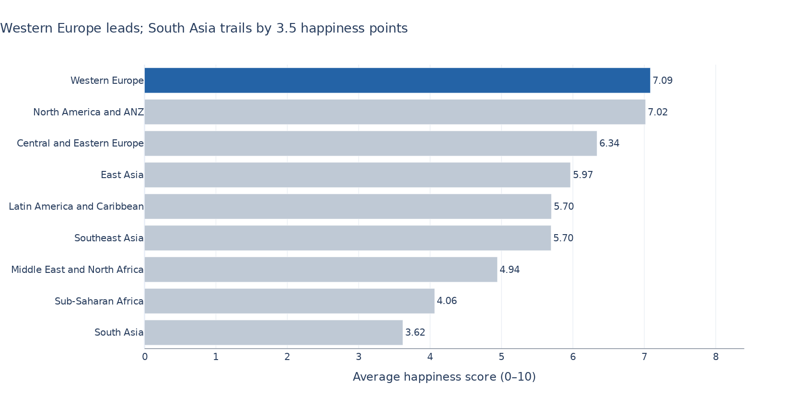
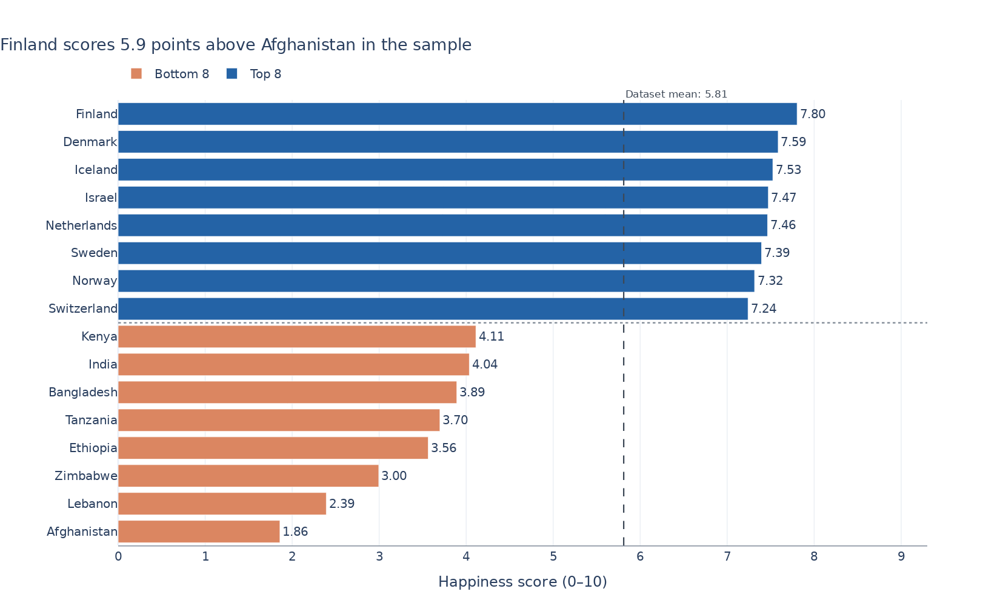
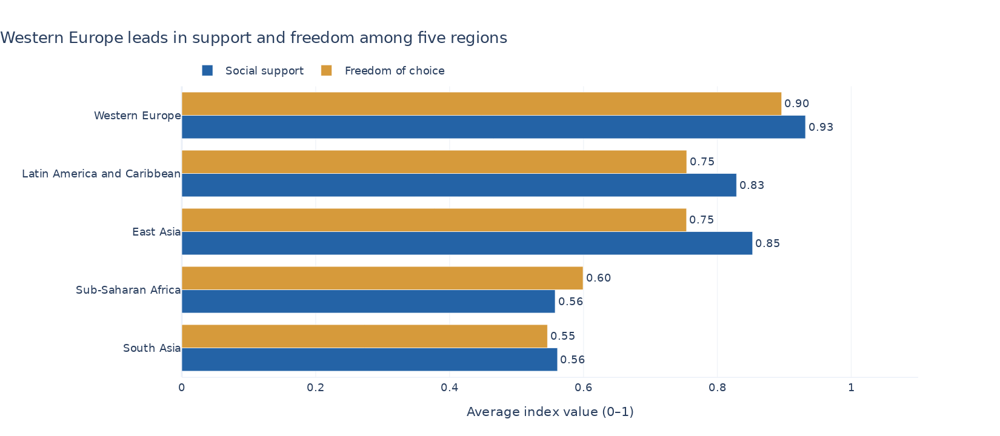

# Week 2 — Chart previews

[Open the notebook](lecture02_exercise.ipynb) · [Back to repository](../README.md)

## Task 1

[SVG version](outputs/task1_regional_happiness.svg)

## Task 2

[SVG version](outputs/task2_top_bottom_countries.svg)

## Optional task 3

[SVG version](outputs/task3_support_and_freedom.svg)

