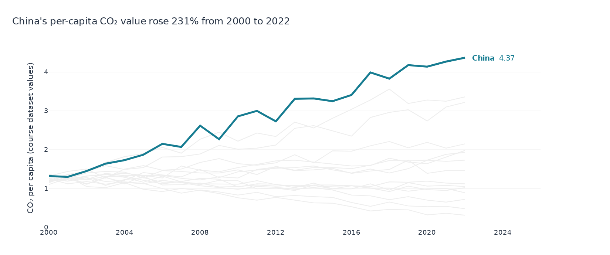
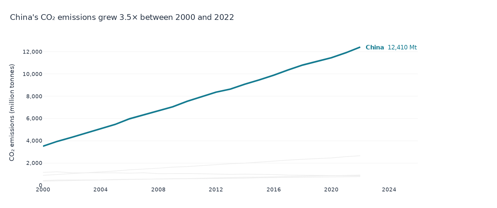

# Week 3 — Chart previews

[Open the notebook](lecture03_exercise.ipynb) · [Back to repository](../README.md)

## Task 1

[SVG version](outputs/task1_co2_per_capita.svg)

## Task 2

[SVG version](outputs/task2_asian_co2_emissions.svg)

## Class material

[Lecture notes](https://github.com/dina-deifallah/data-viz-class-material-w2026/blob/main/week03/lecture03_notes.ipynb) · [Instructor model answer](https://github.com/dina-deifallah/data-viz-class-material-w2026/blob/main/week03/lecture03_model_answer.ipynb)
