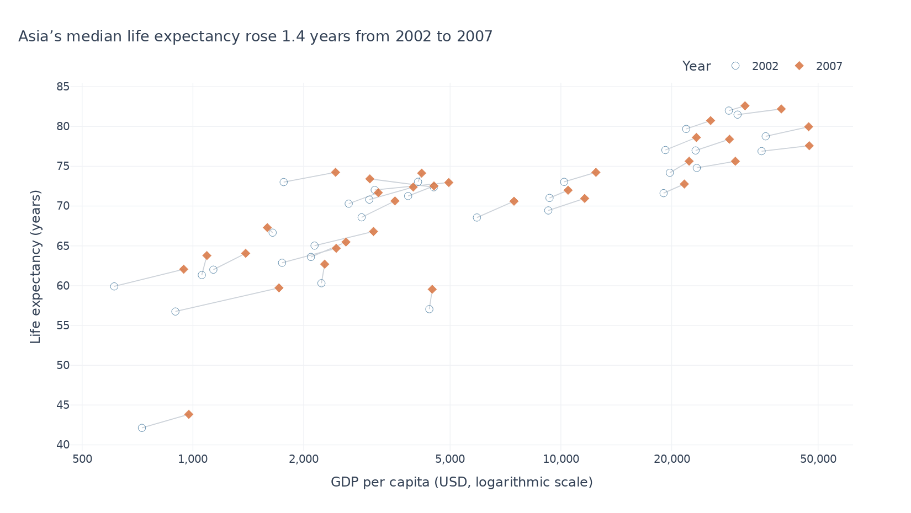
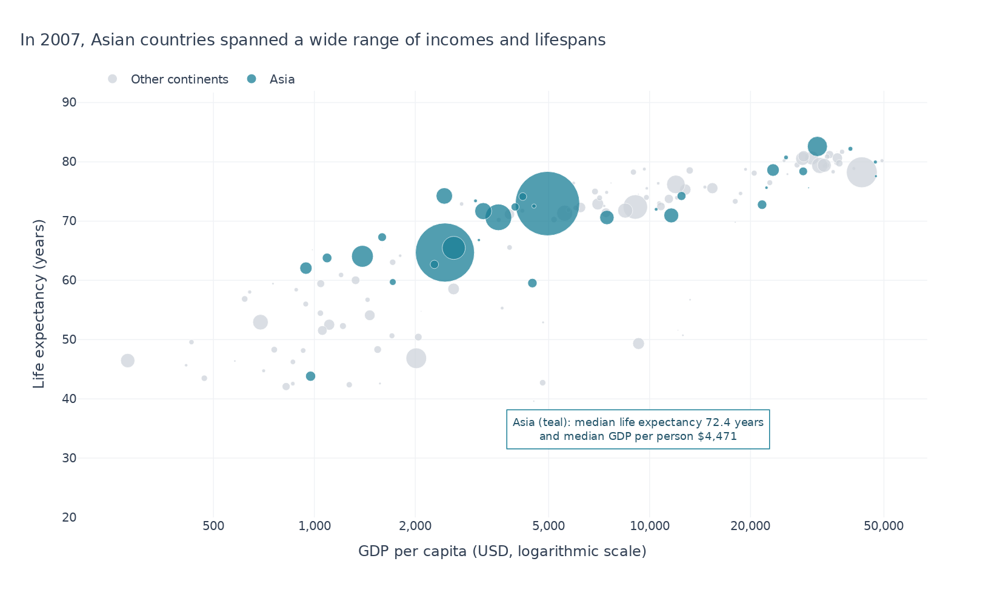

# Week 4 — Chart previews

[Open the notebook](lecture04_exercise.ipynb) · [Back to repository](../README.md)

## Task 1

[SVG version](outputs/task1_asia_2002_2007.svg)

## Task 2

[SVG version](outputs/task2_asia_population_bubbles.svg)

