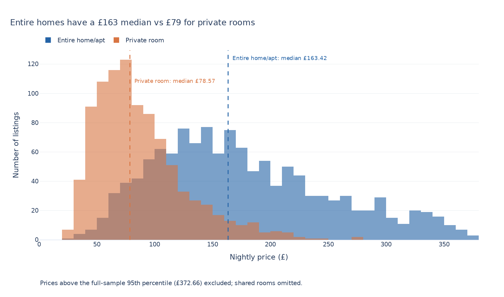
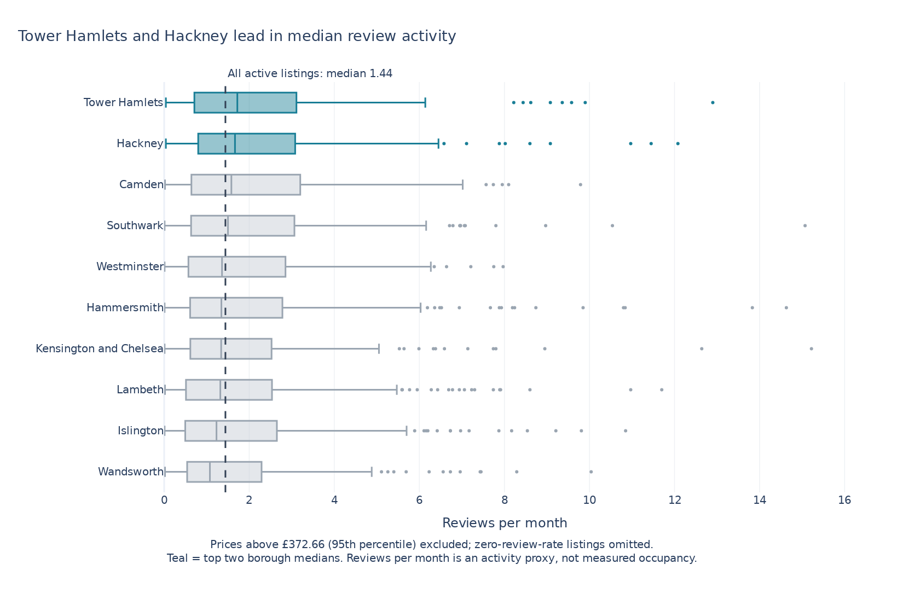

# Week 5 — Distribution charts: Airbnb London

[Open the completed notebook](lecture05_exercise.ipynb) · [Official lecture notes](https://github.com/dina-deifallah/data-viz-class-material-w2026/blob/main/week05/lecture05_notes.ipynb) · [Back to repository](../README.md)

## Task 1 — Price by room type

Overlapping histograms compare entire homes/apartments with private rooms, with common bins and a separate median reference line for each group.

[SVG version](outputs/task1_price_by_room_type.svg)

## Task 2 — Listing activity by borough

Horizontal box plots rank boroughs by median reviews per month, highlight the two leaders, and retain outliers as points.

[SVG version](outputs/task2_reviews_by_borough.svg)

Both charts disclose the 95th-percentile price filter. Reviews per month is an activity proxy, rather than measured bookings or occupancy.
